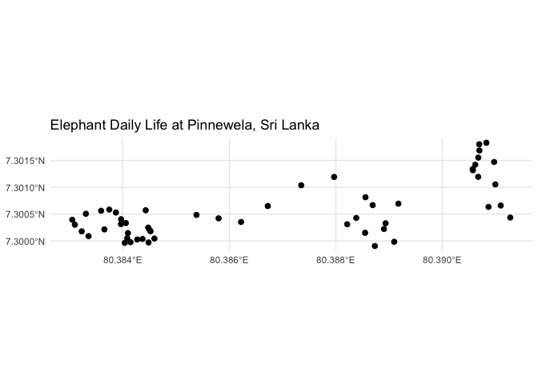
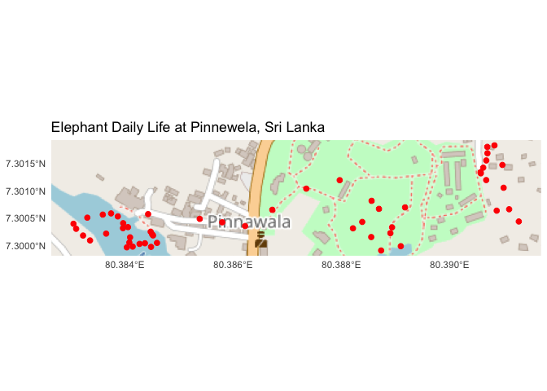
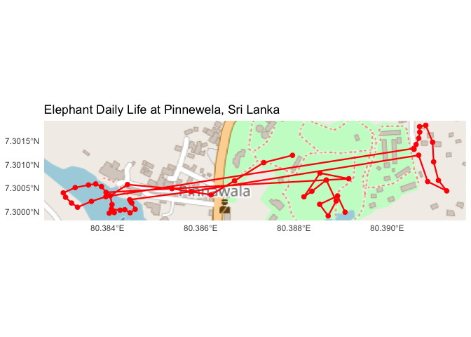
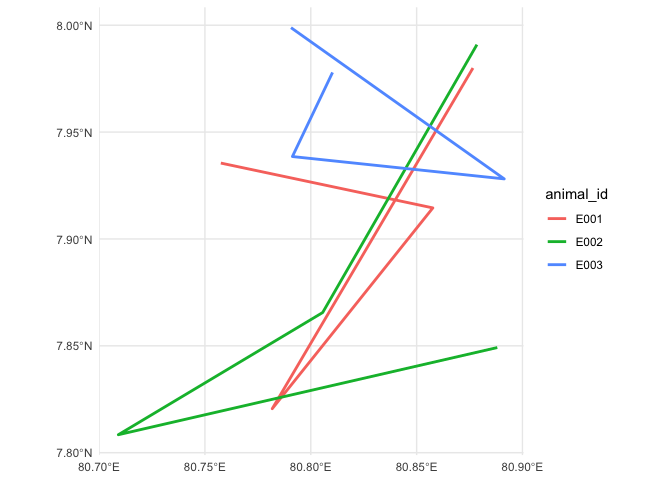
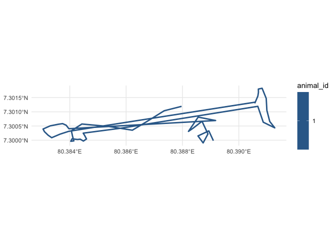

<!-- README.md is generated from README.Rmd. Please edit that file -->

# trackable

<!-- badges: start -->

<!-- badges: end -->

The goal of trackable is to create a data structure for tracking data
analysis.

## Installation

You can install the development version of trackable from
[GitHub](https://github.com/) with:

``` r
# install.packages("pak")
pak::pak("thiyangt/trackable")
```

## Use case

``` r
library(trackable)
## basic example code
```

``` r
set.seed(123)

dat <- tibble::tibble(
   animal_id = rep(c("E001", "E002", "E003"), each = 4),
   time = rep(
     as.POSIXct("2022-01-01 08:00:00", tz = "UTC") +
      86400 * 0:3,
     times = 3
  ),
  x = runif(12, 80.70, 80.90),
  y = runif(12, 7.80, 8.00),
  Length = rep(c(250, 270, 250), each = 4),
  Sex = rep(c("Female", "Male", "Female"), each = 4)
)

dat
#> # A tibble: 12 × 6
#>    animal_id time                    x     y Length Sex   
#>    <chr>     <dttm>              <dbl> <dbl>  <dbl> <chr> 
#>  1 E001      2022-01-01 08:00:00  80.8  7.94    250 Female
#>  2 E001      2022-01-02 08:00:00  80.9  7.91    250 Female
#>  3 E001      2022-01-03 08:00:00  80.8  7.82    250 Female
#>  4 E001      2022-01-04 08:00:00  80.9  7.98    250 Female
#>  5 E002      2022-01-01 08:00:00  80.9  7.85    270 Male  
#>  6 E002      2022-01-02 08:00:00  80.7  7.81    270 Male  
#>  7 E002      2022-01-03 08:00:00  80.8  7.87    270 Male  
#>  8 E002      2022-01-04 08:00:00  80.9  7.99    270 Male  
#>  9 E003      2022-01-01 08:00:00  80.8  7.98    250 Female
#> 10 E003      2022-01-02 08:00:00  80.8  7.94    250 Female
#> 11 E003      2022-01-03 08:00:00  80.9  7.93    250 Female
#> 12 E003      2022-01-04 08:00:00  80.8  8.00    250 Female

trk <- trackable(
 data = dat,
 time = time,
  x = x,
  y = y,
 key = c("animal_id", "Length", "Sex"),
  crs = 4326
)

trk
#> # A trackable: 12 x 6 [4D]
#> #> # Key:       animal_id, Length, Sex [3]
#> # A tibble: 12 × 6
#>    animal_id time                    x     y Length Sex   
#>    <chr>     <dttm>              <dbl> <dbl>  <dbl> <chr> 
#>  1 E001      2022-01-01 08:00:00  80.8  7.94    250 Female
#>  2 E001      2022-01-02 08:00:00  80.9  7.91    250 Female
#>  3 E001      2022-01-03 08:00:00  80.8  7.82    250 Female
#>  4 E001      2022-01-04 08:00:00  80.9  7.98    250 Female
#>  5 E002      2022-01-01 08:00:00  80.9  7.85    270 Male  
#>  6 E002      2022-01-02 08:00:00  80.7  7.81    270 Male  
#>  7 E002      2022-01-03 08:00:00  80.8  7.87    270 Male  
#>  8 E002      2022-01-04 08:00:00  80.9  7.99    270 Male  
#>  9 E003      2022-01-01 08:00:00  80.8  7.98    250 Female
#> 10 E003      2022-01-02 08:00:00  80.8  7.94    250 Female
#> # ℹ 2 more rows

# Access spatial features
sf::st_geometry(trk)
#> Geometry set for 12 features 
#> Geometry type: POINT
#> Dimension:     XY
#> Bounding box:  xmin: 80.70911 ymin: 7.808412 xmax: 80.89137 ymax: 7.998854
#> Geodetic CRS:  WGS 84
#> First 5 geometries:
#> POINT (80.75752 7.935514)
#> POINT (80.85766 7.914527)
#> POINT (80.7818 7.820585)
#> POINT (80.8766 7.979965)
#> POINT (80.88809 7.849218)

# Access tracking metadata
attr(trk, "trackable_key")
#> [1] "animal_id" "Length"    "Sex"
attr(trk, "trackable_time")
#> [1] "time"

# Filter observations using dplyr
dplyr::filter(trk, animal_id == "E001")
#> Simple feature collection with 4 features and 6 fields
#> Geometry type: POINT
#> Dimension:     XY
#> Bounding box:  xmin: 80.75752 ymin: 7.820585 xmax: 80.8766 ymax: 7.979965
#> Geodetic CRS:  WGS 84
#> # A trackable: 4 x 6 [4D]
#> #> # Key:       animal_id, Length, Sex [1]
#> # A tibble: 4 × 6
#>   animal_id time                    x     y Length Sex   
#>   <chr>     <dttm>              <dbl> <dbl>  <dbl> <chr> 
#> 1 E001      2022-01-01 08:00:00  80.8  7.94    250 Female
#> 2 E001      2022-01-02 08:00:00  80.9  7.91    250 Female
#> 3 E001      2022-01-03 08:00:00  80.8  7.82    250 Female
#> 4 E001      2022-01-04 08:00:00  80.9  7.98    250 Female
```

## Build-in dataset

``` r
library(lubridate)
#> 
#> Attaching package: 'lubridate'
#> The following objects are masked from 'package:base':
#> 
#>     date, intersect, setdiff, union
data("pinnawala")
head(pinnawala)
#> # A tibble: 6 × 4
#>   time  longitude latitude note                          
#>   <chr>     <dbl>    <dbl> <chr>                         
#> 1 08:30      80.4     7.30 Given anchor point            
#> 2 08:40      80.4     7.30 10-min interval (interpolated)
#> 3 08:50      80.4     7.30 10-min interval (interpolated)
#> 4 09:00      80.4     7.30 10-min interval (interpolated)
#> 5 09:10      80.4     7.30 10-min interval (interpolated)
#> 6 09:20      80.4     7.30 10-min interval (interpolated)
pinnawala$animal_id <- rep(1, 53)
pinnawala$datetime <- ymd_hm(
  paste("2026-8-23", pinnawala$time),
  tz = "Asia/Colombo"
)

trk_elephant <- trackable(
  data = pinnawala,
  time = datetime,
  x = longitude,
  y = latitude,
  key = c("animal_id"),
  crs = 4326
)
trk_elephant
#> # A trackable: 53 x 6 [9.5D]
#> #> # Key:       animal_id [1]
#> # A tibble: 53 × 6
#>    time  longitude latitude note                   animal_id datetime           
#>    <chr>     <dbl>    <dbl> <chr>                      <dbl> <dttm>             
#>  1 08:30      80.4     7.30 Given anchor point             1 2026-08-23 08:30:00
#>  2 08:40      80.4     7.30 10-min interval (inte…         1 2026-08-23 08:40:00
#>  3 08:50      80.4     7.30 10-min interval (inte…         1 2026-08-23 08:50:00
#>  4 09:00      80.4     7.30 10-min interval (inte…         1 2026-08-23 09:00:00
#>  5 09:10      80.4     7.30 10-min interval (inte…         1 2026-08-23 09:10:00
#>  6 09:20      80.4     7.30 10-min interval (inte…         1 2026-08-23 09:20:00
#>  7 09:30      80.4     7.30 10-min interval (inte…         1 2026-08-23 09:30:00
#>  8 09:40      80.4     7.30 10-min interval (inte…         1 2026-08-23 09:40:00
#>  9 09:50      80.4     7.30 10-min interval (inte…         1 2026-08-23 09:50:00
#> 10 10:00      80.4     7.30 Given anchor point             1 2026-08-23 10:00:00
#> # ℹ 43 more rows
```

``` r
library(ggplot2)
library(sf)
#> Linking to GEOS 3.13.0, GDAL 3.8.5, PROJ 9.5.1; sf_use_s2() is TRUE
ggplot() +
  geom_sf(data = trk_elephant, aes(), size = 2) +
  theme_minimal() +
  labs(
    title = "Elephant Daily Life at Pinnewela, Sri Lanka",
    x = NULL,
    y = NULL
  )
```



``` r

library(ggplot2)
library(sf)
library(ggspatial)
#> Warning: package 'ggspatial' was built under R version 4.6.1
library(prettymapr)

library(sf)
library(dplyr)
#> 
#> Attaching package: 'dplyr'
#> The following objects are masked from 'package:stats':
#> 
#>     filter, lag
#> The following objects are masked from 'package:base':
#> 
#>     intersect, setdiff, setequal, union
library(ggplot2)
library(ggspatial)


ggplot() +
  annotation_map_tile(type = "osm", zoom = 16) +
  geom_sf(data = trk_elephant, size = 2, colour = "red") +  
  theme_minimal() +
  labs(
    title = "Elephant Daily Life at Pinnewela, Sri Lanka",
    x = NULL,
    y = NULL
  )
#> Zoom: 16
```



``` r
library(sf)
library(dplyr)

# 1. plain tibble first (drops the track class), sorted by time
trk_pts <- trk_elephant |>
  as_tibble() |>
  arrange(datetime)

# 2. make points (skip this step if it already has a geometry column)
trk_pts <- st_as_sf(trk_pts, coords = c("longitude", "latitude"), crs = 4326)

# 3. join the points, in order, into one line
trk_line <- trk_pts |>
  summarise(do_union = FALSE) |>
  st_cast("LINESTRING")
```

``` r
ggplot() +
  annotation_map_tile(type = "osm", zoom = 16) +
  geom_sf(data = trk_line, colour = "red", linewidth = 0.8) +
  geom_sf(data = trk_pts, size = 2, colour = "red") +
  theme_minimal() +
  labs(title = "Elephant Daily Life at Pinnewela, Sri Lanka", x = NULL, y = NULL)
#> Zoom: 16
```



Animate

``` r
library(ggplot2)
library(ggspatial)
library(gganimate)
library(dplyr)

trk_df <- trk_elephant |>
  as_tibble() |>
  arrange(datetime)

p <- ggplot(trk_df, aes(longitude, latitude)) +
  annotation_map_tile(type = "osm", zoom = 16) +
  geom_path(colour = "red", linewidth = 0.8) +
  geom_point(colour = "red", size = 3) +
  coord_sf(crs = 3857, default_crs = 4326) +   # match the map tiles
  theme_minimal() +
  labs(
    title = "Elephant Daily Life at Pinnewela, Sri Lanka",
    subtitle = "Time: {format(frame_along, '%H:%M')}",
    x = NULL, y = NULL
  ) +
  transition_reveal(datetime)
```

## trackable_line

`trackable_lines()` function that converts the point-based trackable
object into an sf LINESTRING object.

``` r
# Create point-based trackable object
trk <- trackable(
  data = dat,
  time = time,
  x = x,
  y = y,
  key = c("animal_id", "Length", "Sex"),
  crs = 4326
)

# Convert points into trajectories
trk_line <- trackable_lines(trk)

# Inspect
trk_line
#> Simple feature collection with 3 features and 6 fields
#> Geometry type: LINESTRING
#> Dimension:     XY
#> Bounding box:  xmin: 80.70911 ymin: 7.808412 xmax: 80.89137 ymax: 7.998854
#> Geodetic CRS:  WGS 84
#> # A tibble: 3 × 7
#>   animal_id Length Sex    start_time          end_time            n_obs
#>   <chr>      <dbl> <chr>  <dttm>              <dttm>              <int>
#> 1 E001         250 Female 2022-01-01 08:00:00 2022-01-04 08:00:00     4
#> 2 E002         270 Male   2022-01-01 08:00:00 2022-01-04 08:00:00     4
#> 3 E003         250 Female 2022-01-01 08:00:00 2022-01-04 08:00:00     4
#> # ℹ 1 more variable: geometry <LINESTRING [°]>

# View geometry
sf::st_geometry(trk_line)
#> Geometry set for 3 features 
#> Geometry type: LINESTRING
#> Dimension:     XY
#> Bounding box:  xmin: 80.70911 ymin: 7.808412 xmax: 80.89137 ymax: 7.998854
#> Geodetic CRS:  WGS 84
#> LINESTRING (80.75752 7.935514, 80.85766 7.91452...
#> LINESTRING (80.88809 7.849218, 80.70911 7.80841...
#> LINESTRING (80.81029 7.977908, 80.79132 7.93856...

# Plot trajectories
library(ggplot2)

ggplot(trk_line) +
  geom_sf(aes(colour = animal_id), linewidth = 1) +
  theme_minimal()
```



``` r
track_lines_pinnewela <- trackable_lines(trk_elephant)
ggplot(track_lines_pinnewela) +
  geom_sf(aes(colour = animal_id), linewidth = 1) +
  theme_minimal()
```



## Forecast

``` r
library(tibble)
elephant_tibble <- tibble::tibble(
 animal_id = "E001",
 time = as.POSIXct("2026-11-18 06:00:00") +
    (0:4) * 3600,
 x = c(500000, 500120, 500260, 500390, 500530),
 y = c(850000, 850040, 850090, 850130, 850180)
 )
elephant_track <- trackable(data = elephant_tibble,
time = time, x=x, y=y, crs = 4326, key = animal_id)
track_forecast_baseline(elephant_track)
#> # A tibble: 1 × 4
#>   animal_id time                     x      y
#>   <chr>     <dttm>               <dbl>  <dbl>
#> 1 E001      2026-11-18 11:00:00 500665 850225
```

## Track activity

``` r
track_activity(trk, by="hour")
#> # A tibble: 4 × 6
#>   period              n_observations total_distance_m mean_speed_m_s
#>   <dttm>                       <int>            <dbl>          <dbl>
#> 1 2022-01-01 08:00:00              3               0         NA     
#> 2 2022-01-02 08:00:00              3            8778.         0.102 
#> 3 2022-01-03 08:00:00              3           13175.         0.152 
#> 4 2022-01-04 08:00:00              3            5998.         0.0694
#> # ℹ 2 more variables: max_speed_m_s <dbl>, active_observations <int>
track_activity(trk, by="month")
#> # A tibble: 1 × 6
#>   period              n_observations total_distance_m mean_speed_m_s
#>   <dttm>                       <int>            <dbl>          <dbl>
#> 1 2022-01-01 00:00:00             12           27952.          0.108
#> # ℹ 2 more variables: max_speed_m_s <dbl>, active_observations <int>
```
