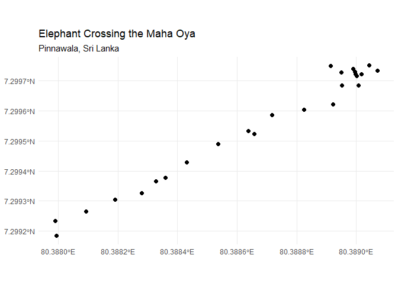
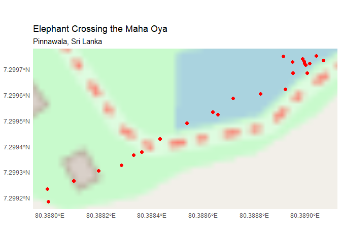

<!-- README.md is generated from README.Rmd. Please edit that file -->

# trackable

<!-- badges: start -->

<!-- badges: end -->

The goal of trackable is to create a data structure for tracking data
analysis.

## Installation

You can install the development version of trackable from
[GitHub](https://github.com/) with:

``` r
# install.packages("pak")
pak::pak("thiyangt/trackable")
```

## Use case

``` r
library(trackable)
## basic example code
```

``` r
set.seed(123)

dat <- tibble::tibble(
   animal_id = rep(c("E001", "E002", "E003"), each = 4),
   time = rep(
     as.POSIXct("2022-01-01 08:00:00", tz = "UTC") +
      86400 * 0:3,
     times = 3
  ),
  x = runif(12, 80.70, 80.90),
  y = runif(12, 7.80, 8.00),
  Length = rep(c(250, 270, 250), each = 4),
  Sex = rep(c("Female", "Male", "Female"), each = 4)
)

dat
#> # A tibble: 12 × 6
#>    animal_id time                    x     y Length Sex   
#>    <chr>     <dttm>              <dbl> <dbl>  <dbl> <chr> 
#>  1 E001      2022-01-01 08:00:00  80.8  7.94    250 Female
#>  2 E001      2022-01-02 08:00:00  80.9  7.91    250 Female
#>  3 E001      2022-01-03 08:00:00  80.8  7.82    250 Female
#>  4 E001      2022-01-04 08:00:00  80.9  7.98    250 Female
#>  5 E002      2022-01-01 08:00:00  80.9  7.85    270 Male  
#>  6 E002      2022-01-02 08:00:00  80.7  7.81    270 Male  
#>  7 E002      2022-01-03 08:00:00  80.8  7.87    270 Male  
#>  8 E002      2022-01-04 08:00:00  80.9  7.99    270 Male  
#>  9 E003      2022-01-01 08:00:00  80.8  7.98    250 Female
#> 10 E003      2022-01-02 08:00:00  80.8  7.94    250 Female
#> 11 E003      2022-01-03 08:00:00  80.9  7.93    250 Female
#> 12 E003      2022-01-04 08:00:00  80.8  8.00    250 Female

trk <- trackable(
 data = dat,
 time = time,
  x = x,
  y = y,
 key = c("animal_id", "Length", "Sex"),
  crs = 4326
)

trk
#> # A trackable: 12 x 6 [4D]
#> #> # Key:       animal_id, Length, Sex [3]
#> # A tibble: 12 × 6
#>    animal_id time                    x     y Length Sex   
#>    <chr>     <dttm>              <dbl> <dbl>  <dbl> <chr> 
#>  1 E001      2022-01-01 08:00:00  80.8  7.94    250 Female
#>  2 E001      2022-01-02 08:00:00  80.9  7.91    250 Female
#>  3 E001      2022-01-03 08:00:00  80.8  7.82    250 Female
#>  4 E001      2022-01-04 08:00:00  80.9  7.98    250 Female
#>  5 E002      2022-01-01 08:00:00  80.9  7.85    270 Male  
#>  6 E002      2022-01-02 08:00:00  80.7  7.81    270 Male  
#>  7 E002      2022-01-03 08:00:00  80.8  7.87    270 Male  
#>  8 E002      2022-01-04 08:00:00  80.9  7.99    270 Male  
#>  9 E003      2022-01-01 08:00:00  80.8  7.98    250 Female
#> 10 E003      2022-01-02 08:00:00  80.8  7.94    250 Female
#> # ℹ 2 more rows

# Access spatial features
sf::st_geometry(trk)
#> Geometry set for 12 features 
#> Geometry type: POINT
#> Dimension:     XY
#> Bounding box:  xmin: 80.70911 ymin: 7.808412 xmax: 80.89137 ymax: 7.998854
#> Geodetic CRS:  WGS 84
#> First 5 geometries:
#> POINT (80.75752 7.935514)
#> POINT (80.85766 7.914527)
#> POINT (80.7818 7.820585)
#> POINT (80.8766 7.979965)
#> POINT (80.88809 7.849218)

# Access tracking metadata
attr(trk, "trackable_key")
#> [1] "animal_id" "Length"    "Sex"
attr(trk, "trackable_time")
#> [1] "time"

# Filter observations using dplyr
dplyr::filter(trk, animal_id == "E001")
#> Simple feature collection with 4 features and 6 fields
#> Geometry type: POINT
#> Dimension:     XY
#> Bounding box:  xmin: 80.75752 ymin: 7.820585 xmax: 80.8766 ymax: 7.979965
#> Geodetic CRS:  WGS 84
#> # A trackable: 4 x 6 [4D]
#> #> # Key:       animal_id, Length, Sex [1]
#> # A tibble: 4 × 6
#>   animal_id time                    x     y Length Sex   
#>   <chr>     <dttm>              <dbl> <dbl>  <dbl> <chr> 
#> 1 E001      2022-01-01 08:00:00  80.8  7.94    250 Female
#> 2 E001      2022-01-02 08:00:00  80.9  7.91    250 Female
#> 3 E001      2022-01-03 08:00:00  80.8  7.82    250 Female
#> 4 E001      2022-01-04 08:00:00  80.9  7.98    250 Female
```

# Example with toy dataset

``` r
data(elephant_crossing_maha_oya_pinnawala)
trk_elephant <- trackable(
  data = elephant_crossing_maha_oya_pinnawala,
  time = date_time,
  x = longitude,
  y = latitude,
  key = c("animal_id", "sex", "age_class"),
  crs = 4326
)
trk_elephant
#> # A trackable: 25 x 9 [3D]
#> #> # Key:       animal_id, sex, age_class [1]
#> # A tibble: 25 × 9
#>    animal_id date_time           latitude longitude location     sex   age_class
#>    <chr>     <dttm>                 <dbl>     <dbl> <chr>        <lgl> <chr>    
#>  1 ELE_001   2026-10-21 10:00:00     7.30      80.4 Maha Oya, P… FALSE Adult    
#>  2 ELE_001   2026-10-21 10:05:00     7.30      80.4 Maha Oya, P… FALSE Adult    
#>  3 ELE_001   2026-10-21 10:10:00     7.30      80.4 Maha Oya, P… FALSE Adult    
#>  4 ELE_001   2026-10-21 10:15:00     7.30      80.4 Maha Oya, P… FALSE Adult    
#>  5 ELE_001   2026-10-21 10:20:00     7.30      80.4 Maha Oya, P… FALSE Adult    
#>  6 ELE_001   2026-10-21 10:25:00     7.30      80.4 Maha Oya, P… FALSE Adult    
#>  7 ELE_001   2026-10-21 10:30:00     7.30      80.4 Maha Oya, P… FALSE Adult    
#>  8 ELE_001   2026-10-21 10:35:00     7.30      80.4 Maha Oya, P… FALSE Adult    
#>  9 ELE_001   2026-10-21 10:40:00     7.30      80.4 Maha Oya, P… FALSE Adult    
#> 10 ELE_001   2026-10-21 10:45:00     7.30      80.4 Maha Oya, P… FALSE Adult    
#> # ℹ 15 more rows
#> # ℹ 2 more variables: movement_phase <chr>, distance_m <dbl>
```

``` r
library(ggplot2)
library(sf)
#> Linking to GEOS 3.14.1, GDAL 3.12.1, PROJ 9.7.1; sf_use_s2() is TRUE
ggplot() +
  geom_sf(data = trk_elephant, aes(), size = 2) +
  theme_minimal() +
  labs(
    title = "Elephant Crossing the Maha Oya",
    subtitle = "Pinnawala, Sri Lanka",
    x = NULL,
    y = NULL
  )
```



``` r

library(ggplot2)
library(sf)
library(ggspatial)
library(prettymapr)

ggplot() +
  annotation_map_tile(type = "osm", zoom = 16) +
  geom_sf(
    data = trk_elephant,
    size = 2,
    colour = "red"
  ) +
  theme_minimal() +
  labs(
    title = "Elephant Crossing the Maha Oya",
    subtitle = "Pinnawala, Sri Lanka",
    x = NULL,
    y = NULL
  )
#> Zoom: 16
#> Fetching 1 missing tiles
#>   |                                                                              |                                                                      |   0%  |                                                                              |======================================================================| 100%
#> ...complete!
```


